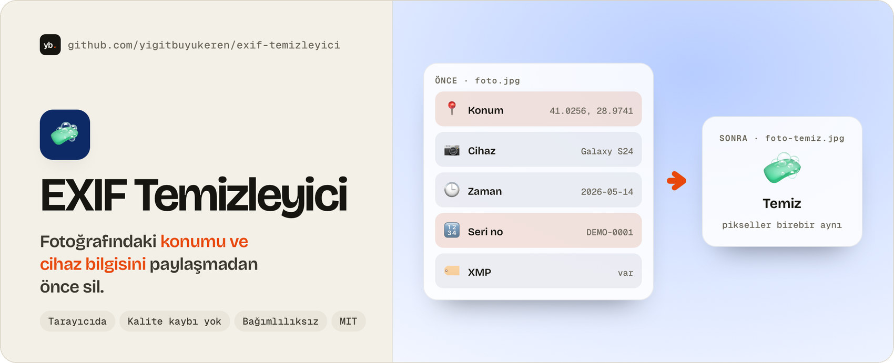
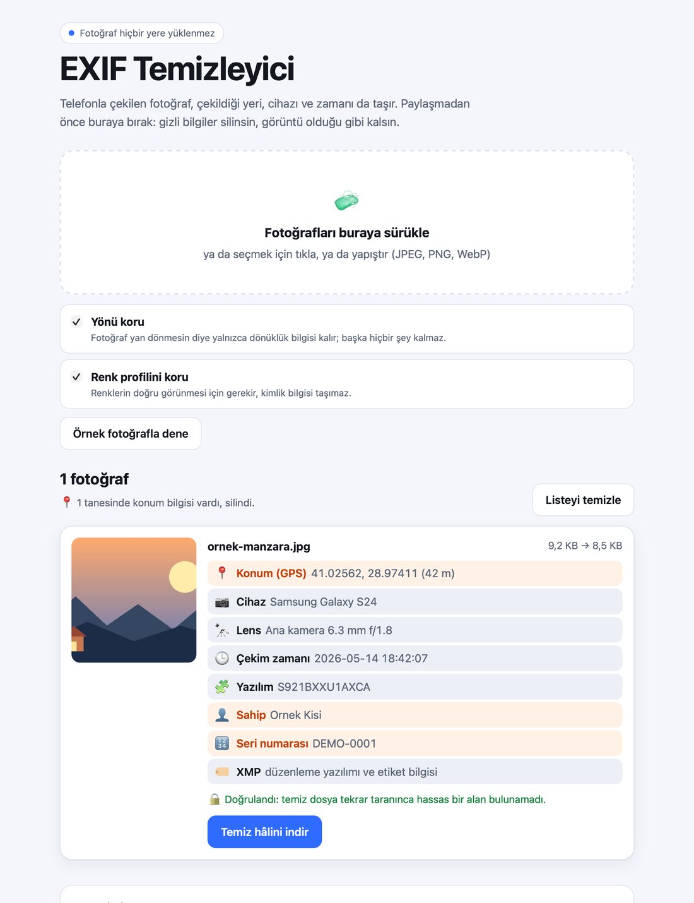

<a href="https://yigitbuyukeren.github.io/exif-temizleyici/">
  <picture>
    <source media="(prefers-color-scheme: dark)" srcset="docs/banner-dark.jpg">
    
  </picture>
</a>

<div align="center">

**[🌐 Demo](https://yigitbuyukeren.github.io/exif-temizleyici/?demo)** &nbsp;·&nbsp; **[🧼 Aracı kullan](https://yigitbuyukeren.github.io/exif-temizleyici/)** &nbsp;·&nbsp; **[🚀 Nasıl kullanılır](#-nasıl-kullanılır)** &nbsp;·&nbsp; **[🔍 Neleri siler](#-neleri-siler)** &nbsp;·&nbsp; **[🐞 Sorun bildir](https://github.com/yigitbuyukeren/exif-temizleyici/issues)**

[](LICENSE)


[](https://github.com/yigitbuyukeren/exif-temizleyici/actions)

🇹🇷 [Türkçe](#-türkçe) &nbsp;·&nbsp; 🇬🇧 [English](#-english)

</div>

<details open>
<summary><h2>🇹🇷 Türkçe</h2></summary>

Telefonla çekilen bir fotoğraf yalnızca görüntüyü değil, **çekildiği yeri (GPS), cihazı, lensi, seri numarasını ve zamanı** da taşır. Bunu sosyal medyaya, ilana ya da mesaja öylece göndermek evinin adresini vermek anlamına gelebilir. Fotoğrafı bu sayfaya bırakırsın, tarayıcın gizli bilgileri siler ve temiz hâlini indirirsin. **Sunucu, hesap, yükleme yok; fotoğraf cihazından çıkmaz.**

<p align="center">
  <picture>
    <source media="(prefers-color-scheme: dark)" srcset="docs/ekran-dark.jpg">
    
  </picture>
</p>

<p align="center"><sub>Ekran görüntüsündeki fotoğraf ve bilgiler uydurmadır (örnek fotoğraf düğmesi).</sub></p>

| 🔒 **%100 yerel** | 🖼️ **Kalite kaybı yok** | 📋 **Ne silindiğini gösterir** | 🧩 **Bağımlılıksız** |
|:---:|:---:|:---:|:---:|
| Sayfa ağa bağlanamaz, güvenlik politikasıyla kilitli | Görüntü yeniden sıkıştırılmaz, pikseller birebir aynı | Konum, cihaz, zaman ve gizli ekler tek tek listelenir | Saf JavaScript, kütüphane yok |

### 🚀 Nasıl kullanılır
1. 🌐 [Canlı demoyu](https://yigitbuyukeren.github.io/exif-temizleyici/) aç (ya da aşağıdaki gibi kendi bilgisayarında çalıştır). İstersen önce **Örnek fotoğrafla dene** düğmesine bas.
2. 🖼️ Fotoğrafları sayfaya **sürükle**, **seç** ya da **yapıştır**. Birden çok dosya bırakabilirsin.
3. 📋 Listede her fotoğrafta nelerin bulunup silindiğini gör.
4. ⬇️ Tek tek ya da hepsini **.zip** olarak indir.

Sayfayı kendi bilgisayarında açmak için:

```bash
python3 -m http.server 8000
```

Sonra tarayıcıda `http://localhost:8000` adresini aç. (`index.html`'e çift tıklamak da çoğu tarayıcıda çalışır.)

**Dosya yüklemeden denemek istersen:** [demo sayfası](https://yigitbuyukeren.github.io/exif-temizleyici/?demo) yalnızca uydurma örnek fotoğrafı temizler, dosya kabul etmez.

#### ⌨️ Komut satırı
Toplu iş için aynı kod terminalden de çalışır (Node 18+, kurulum yok):

```bash
node cli.js foto.jpg                  # foto-temiz.jpg yazar, özgün dosyaya dokunmaz
node cli.js klasor/ -o temiz/         # klasördeki JPEG, PNG, WebP hepsini temizler
node cli.js foto.jpg --yon-sil --renk-sil
```

Her dosya için nelerin silindiği yazılır; hata olursa çıkış kodu 1 döner.

### 🔍 Neleri siler

| Alan | Örnek |
|---|---|
| 📍 **Konum** | GPS enlem, boylam, irtifa |
| 📷 **Cihaz** | Marka, model, lens, seri numarası, yazılım sürümü |
| 🕒 **Zaman** | Çekim ve düzenleme tarihi |
| 👤 **Kişi** | Sahip, yazar, telif ve açıklama alanları |
| 🏷️ **Gömülü metin** | XMP, IPTC / Photoshop, JPEG yorumları, PNG metin parçaları |
| 📎 **Gizli ekler** | Gömülü küçük resim, çoklu resim (MPF) verisi, hareketli fotoğraf videosu, dosya bitişinden sonra eklenmiş veri |

| Biçim | Nasıl temizlenir |
|---|---|
| **JPEG** | Bölümler tek tek gezilir, kimlik taşıyanlar atılır; sıkıştırılmış görüntü verisi **bayt bayt aynı** kalır |
| **PNG** | Metin, EXIF ve zaman parçaları atılır; görüntü parçaları aynen kalır (hareketli PNG dahil) |
| **WebP** | EXIF ve XMP parçaları atılır, başlık bayrakları düzeltilir (hareketli WebP dahil) |
| **HEIC, GIF, BMP, AVIF…** | Tarayıcı açabiliyorsa görüntü yeniden çizilip **PNG** olarak hazırlanır (hareketli GIF'te yalnızca ilk kare) |

**Seçenekler:** *Yönü koru* açıkken fotoğrafın yan dönmesini engellemek için yalnızca dönüklük (Orientation) bilgisi içeren, başka hiçbir alan taşımayan küçük bir EXIF bırakılır. *Renk profilini koru* renklerin doğru görünmesini sağlar ve kimlik bilgisi taşımaz. İkisini de kapatırsan dosyada hiçbir ek bilgi kalmaz.

### 🔧 Nasıl çalışıyor
- **JPEG** ([`src/jpeg.js`](src/jpeg.js)): `FFxx` işaretçilerini sırayla okur. `APP1` (EXIF, XMP), `APP13` (IPTC), `COM` (yorum), `MPF` ve bilinmeyen `APPn` bölümlerini atar; `JFIF` içindeki küçük resmi kaldırır; ilk tarama başlığından itibaren (ilerlemeli JPEG'in tüm taramaları dahil) veriyi aynen kopyalar. Bitiş işaretçisinden sonraki her şey atılır.
- **PNG** ([`src/png.js`](src/png.js)) ve **WebP** ([`src/webp.js`](src/webp.js)): parçaları gezer, izin verilenleri CRC'leri bozulmadan kopyalar.
- **EXIF okuyucu** ([`src/exif.js`](src/exif.js)): TIFF yapısını (iki bayt sırası, IFD0, Exif ve GPS alt dizinleri) sınır kontrolleriyle okur, bozuk dosyada hata değil boş sonuç döner. Aynı dosya, yön korunurken tek etiketli bir EXIF kurmak için küçük bir yazıcı da içerir.
- **Doğrulama:** Temiz dosya tekrar taranır; hassas bir alan bulunursa arayüz uyarır.
- **Zip** ([`src/zip.js`](src/zip.js)): sıkıştırmasız (fotoğraflar zaten sıkışık), zaman damgası sabit, bağımlılıksız.

### 🔒 Gizlilik
- `index.html` bir **içerik güvenlik politikası** taşır (`connect-src 'none'`): sayfa, sen istesen bile dışarıya istek atamaz.
- Hiçbir analitik, font ya da CDN yoktur; her şey bu depodaki dosyalardan yüklenir.
- Örnek fotoğraf ve testlerdeki veriler uydurmadır; gerçek bir fotoğraf depoda bulunmaz.

### ⚠️ Sınırlar
- Fotoğrafın **içeriği** (yüz, tabela, ev numarası, yansıma) elbette silinmez; yalnızca dosyaya gömülü bilgi silinir.
- Sosyal medya siteleri yüklenen fotoğrafın meta verisini kendileri de temizler, ama bunu garanti etmezler; e-posta, mesajlaşma ve dosya paylaşımında çoğu zaman olduğu gibi gider.
- Dosya adı olduğu gibi kalır (sonuna `-temiz` eklenir); adında kişisel bilgi varsa indirirken değiştir.

### 🛠️ Geliştirme
```bash
npm test        # node --test, bağımlılık kurmak gerekmez (Node 18+)
```
Testler EXIF okuma ve yazma gidiş dönüşünü (GPS işaretleri, iki bayt sırası, bozuk veri), JPEG, PNG ve WebP temizliğini (görüntü verisinin aynı kalması, yön, renk profili, ek veri, bozuk dosyalar) ve zip yazıcıyı kapsar.

### 📜 Lisans
[MIT](LICENSE): kullanabilir, değiştirebilir, dağıtabilirsin. ⭐ İşine yaradıysa yıldız vermeyi unutma!

</details>

<details>
<summary><h2>🇬🇧 English</h2></summary>

A photo from your phone carries more than the picture: **where it was taken (GPS), the device, lens, serial number and the time.** Drop photos on the page and your browser strips that hidden data and hands you the clean files. **No server, no account, no upload; photos never leave your device.** The interface is in Turkish.

**What it removes:** GPS coordinates, camera make/model/lens/serial, software, timestamps, owner and copyright fields, XMP, IPTC, JPEG comments, PNG text chunks, embedded thumbnails, MPF data, motion-photo videos and anything appended after the end of the file. The page lists what it found in each photo, then re-scans the clean file to verify.

**No quality loss:** JPEG, PNG and WebP are cleaned without re-encoding. For JPEG the compressed image data stays byte-for-byte identical. Formats the page cannot clean directly (HEIC, GIF, BMP, AVIF) are redrawn to PNG when the browser can open them. An option keeps only the orientation tag so photos do not turn sideways.

**Run it:** open the [live demo](https://yigitbuyukeren.github.io/exif-temizleyici/), or `python3 -m http.server 8000` and visit `http://localhost:8000`. Try **"Örnek fotoğrafla dene"** for a fake demo photo with fake GPS; the [`?demo` page](https://yigitbuyukeren.github.io/exif-temizleyici/?demo) accepts no uploads at all. **CLI:** `node cli.js photo.jpg` or `node cli.js folder/ -o clean/` writes `*-temiz` copies (Node 18+, nothing to install).

**Privacy:** `index.html` ships a Content-Security-Policy with `connect-src 'none'`, so the page cannot make network requests. No analytics, fonts or CDNs. Note that the visible content of a photo (faces, signs, house numbers) is not touched.

Run the tests with `npm test` (Node 18+, nothing to install). Released under the [MIT License](LICENSE).

</details>
